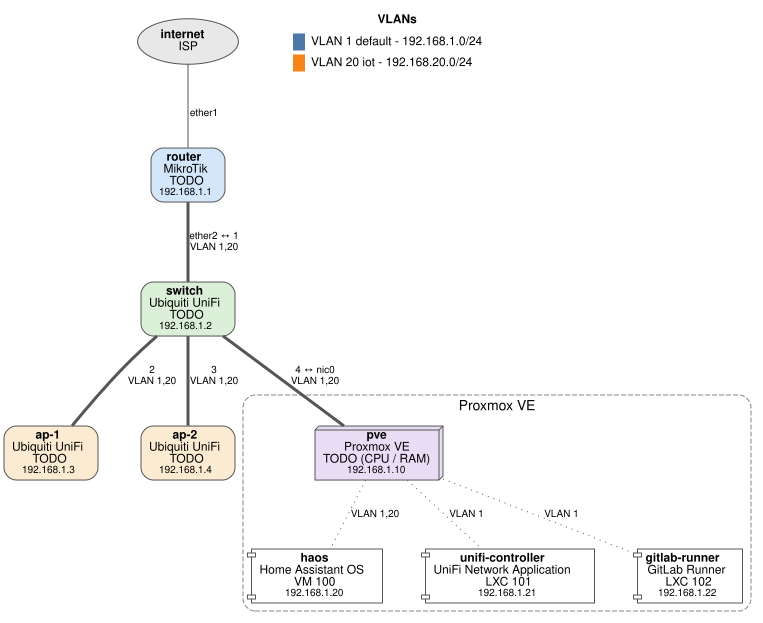

# homelab

Documentation and configuration-as-code for my home network, servers and Home Assistant.
Everything is plain Markdown, read it right here on GitHub.



> [!IMPORTANT]
> This repo is public. It contains **no secrets**: passwords live in a password manager,
> device secrets in git-ignored `secrets.yaml` files. Binary backups (Proxmox, UniFi `.unf`,
> MikroTik `.backup`, HA backups) live on backup storage, never here.
> See [servers/backups.md](servers/backups.md).

## Where to look

| I want to... | Go to |
|---|---|
| See what still needs to be done | [TODO.md](TODO.md) |
| See IPs, VLANs, devices, switch ports, WiFi | [network/inventory.md](network/inventory.md) |
| Understand VLANs and firewall rules | [network/README.md](network/README.md) |
| Router, switch + APs | [MikroTik](network/mikrotik/README.md), [UniFi](network/unifi/README.md) |
| Proxmox host and its guests | [servers/proxmox/README.md](servers/proxmox/README.md) |
| Know what is backed up, where | [servers/backups.md](servers/backups.md) |
| Set up read-only access for scripts | [ACCESS.md](ACCESS.md) |
| Home Assistant | [home-assistant/README.md](home-assistant/README.md) |
| Find how an ESPHome device is wired | [esphome/README.md](esphome/README.md) |

## Disaster? Start here

- Router died -> [servers/runbooks/replace-router.md](servers/runbooks/replace-router.md)
- Proxmox host died -> [servers/runbooks/restore-proxmox.md](servers/runbooks/restore-proxmox.md)

## Keeping it up to date

| Something changed... | Do |
|---|---|
| Device, IP, VLAN, port, WiFi | edit `inventory.yaml`, `make generate` |
| Not sure what changed | `make status`, compare with [network/inventory.md](network/inventory.md) |
| Router config | `make mikrotik-export`, review `git diff` |
| How/why something is set up | edit the `README.md` in that folder |
| New ESPHome device | copy `esphome/devices/_template/`, `make generate` |

Then commit. The pre-commit hook blocks secrets; CI checks that `inventory.md` matches `inventory.yaml`.

## Conventions

- **Facts live in one place.** [`inventory.yaml`](inventory.yaml) holds devices, IPs, VLANs,
  links and WiFi. `make generate` turns it into [`network/inventory.md`](network/inventory.md)
  and the network diagram (both committed, CI checks the Markdown is up to date).
  Other pages explain *why* and *how* and link to the inventory instead of repeating it.
- Each folder's `README.md` documents that part of the setup.
- No secrets in this repo. Secrets are referenced by name (e.g. `!secret wifi_password`).

## Layout

```
inventory.yaml            devices, IPs, VLANs, links, WiFi -> inventory.md + diagram
TODO.md                   next steps checklist
ACCESS.md                 read-only accounts + credentials.env.example
network/
  README.md               design, firewall intent
  inventory.md            generated from inventory.yaml
  diagrams/               generated network.svg + hand-written *.dot
  mikrotik/               README + export.rsc (`make mikrotik-export`, secrets hidden)
  unifi/                  README (controller settings; no .unf!)
servers/
  proxmox/                README (host, storage, guests)
  backups.md              what is backed up, where
  runbooks/               disaster recovery
home-assistant/           README + config/ (HA YAML: packages, automations, ...)
esphome/
  common/                 shared YAML (wifi, api, ota, ...)
  devices/<name>/         <name>.yaml + wiring.yaml + README.md + photos/
scripts/                  generators + read-only status script used by the Makefile
```

## Quick start

```bash
sudo apt install graphviz   # needed for all diagrams
make setup                  # Python venv: wireviz, pre-commit
make hooks                  # pre-commit hooks incl. gitleaks secret scanning
make generate               # regenerate inventory.md + network/wiring diagrams
make check-access           # test read-only access (needs credentials, see ACCESS.md)
make status                 # live router/UniFi/Proxmox state, compare with inventory.yaml
make                        # list all targets
```
