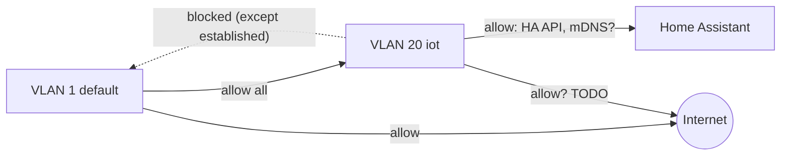

# Network overview

<object data="../../generated/network/network.svg" type="image/svg+xml" style="width:100%">
  
</object>

Exact addresses, devices and ports: see [Inventory](../generated/inventory.md).

## Design

<!-- TODO: describe in words, vendor-neutral. This is what you rebuild from. -->

- **WAN:** TODO (ISP, PPPoE / DHCP, IPv6 yes/no)
- **VLAN 1 `default`:** trusted clients and infrastructure management.
- **VLAN 20 `iot`:** IoT and ESPHome devices. Internet allowed (TODO: or not?), no access to `default`.
- **Trunks:** router -> switch -> APs / Proxmox carry all VLANs tagged (TODO: native VLAN?).
- **DNS:** TODO (router as resolver? upstream?)
- **NTP:** TODO

## Firewall intent

Describe *what* is allowed, not vendor syntax, so it can be rebuilt on any router.

| # | From | To | Service | Action | Why |
|---|------|----|---------|--------|-----|
| 1 | any | router | established/related | accept | stateful firewall |
| 2 | default | any | any | accept | trusted |
| 3 | iot | default | any | drop | isolation |
| 4 | iot | haos | TODO (6053 ESPHome API is HA -> device, so maybe none) | accept | |
| 5 | WAN | any | any | drop | default deny |

## Port forwards / exposed services

| External | Internal | Purpose |
|----------|----------|---------|
| none | | TODO |

## mDNS / discovery across VLANs

TODO: HA discovers ESPHome via mDNS. Either HA has a leg in the IoT VLAN (VM with two NICs/tagged
interface), or enable an mDNS repeater on the router.
