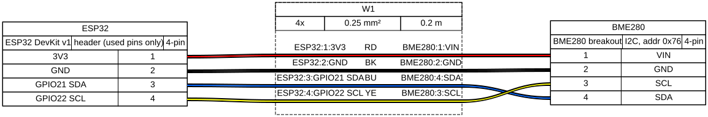

# Template device

Temperature / humidity / pressure sensor. *Replace this with what the device does.*

| | |
|---|---|
| Location | TODO |
| Board | ESP32 DevKit v1 |
| Power | USB 5 V |
| Config | `_template.yaml` |

## Wiring

| ESP32 pin | Goes to | Notes |
|-----------|---------|-------|
| 3V3 | BME280 VIN | |
| GND | BME280 GND | |
| GPIO21 | BME280 SDA | I2C data |
| GPIO22 | BME280 SCL | I2C clock |

## Bill of materials

| Qty | Part | Link / note |
|-----|------|-------------|
| 1 | ESP32 DevKit v1 | |
| 1 | BME280 breakout (I2C) | address 0x76 (SDO -> GND) |
| 4 | Dupont wires | |

## First flash

USB is needed once; after that OTA works (`make esphome-run DEVICE=<name>`).
Easiest first flash: https://web.esphome.io with the compiled `.bin`
(`make esphome-compile DEVICE=<name>`), or pass the serial port to Docker
(`--device /dev/ttyUSB0`).

## Photos

Put photos in `photos/` (strip EXIF GPS: `exiftool -gps:all= photos/*.jpg`).

## Notes / changelog

- YYYY-MM-DD: built
