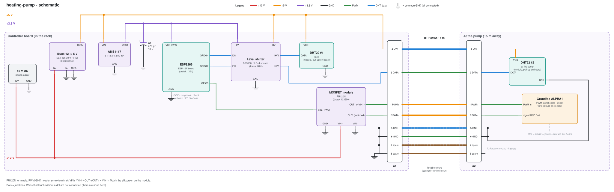

# Heating pump controller

Sets the speed of the Grundfos ALPHA1 heating circulation pump over its PWM signal input.
It also measures temperature and humidity with two DHT22 sensors, one in the rack and one at the pump.

| | |
|---|---|
| Location | rack (board + sensor #1), pump ~5 m away over UTP (sensor #2 + PWM) |
| Board | ESP8266 ESP-12F + CH340 base (dratek 1351), powered with 3.3 V on VCC |
| Power | 12 V DC -> buck 5 V -> AMS1117 3.3 V |
| Config | TODO (not written yet) |

## Schematic

Generated by `schematic.py` (`make generate`):

## Before powering it

- Set the buck to **5.0 V** before connecting anything. It has no short-circuit or reverse-polarity
  protection, and there's no fuse, so use a 12 V supply with its own short-circuit protection.
- Don't plug in USB while 12 V is connected. That would put two regulators on one 3.3 V rail.
- Check the pump signal cable's wire colours (PWM in / signal GND) in the ALPHA1 manual.

## Why

- **FR120N MOSFET module**: it drives its gate through an optocoupler from the 12 V supply, so it
  switches fully from the ESP's 3.3 V output.
- **Fail-safe**: with ALPHA1 heating profile A, no PWM signal means maximum speed. So a dead ESP
  or a cut cable leaves the heating running. This board never switches the pump's 230 V power.
- **DHT22s on 5 V via the level shifter**: more reliable over 5 m. The DHT22 isn't I2C, but the
  BSS138 channels are generic bidirectional shifters, so it works.

## Pin choice (proposed, not final)

The shop page doesn't say which GPIOs the onboard WS2812 LED, LDR and 3 buttons use.
Check them on the board before you settle the pins. Avoid the boot strapping pins GPIO0, GPIO2
and GPIO15, and avoid GPIO16.

| ESP pin | Goes to | Notes |
|---------|---------|-------|
| VCC (3V3) | AMS1117 VOUT | + 470 µF cap |
| GND | common GND | |
| GPIO5 | MOSFET SIG / PWM | PWM 1 kHz, no glitches at boot |
| GPIO14 | shifter LV1 -> HV1 -> DHT22 rack DATA | |
| GPIO12 | shifter LV2 -> HV2 -> UTP pin 3 -> DHT22 pump DATA | check it isn't used by the onboard LED |

## UTP (5 m, T568B)

Each signal shares a twisted pair with its own return.

| Pair | Pin | Colour | Signal |
|------|-----|--------|--------|
| orange | 1 | white-orange | PWM+ (MOSFET OUT+, 12 V) -> pump PWM in |
| orange | 2 | orange | PWM- (MOSFET OUT-) -> pump signal GND |
| green | 3 | white-green | DHT22 DATA (5 V side) |
| blue | 4 | blue | +5 V for DHT22 |
| blue | 5 | white-blue | GND |
| green | 6 | green | GND (return for DATA) |
| brown | 7, 8 | white-brown, brown | spare: GND at the **board end only**, insulated at the pump end. Can later carry the pump's PWM feedback. |

## Bill of materials

| Qty | Part | Link / note |
|-----|------|-------------|
| 1 | 12 V DC supply | ≥ 0.5 A, short-circuit protected |
| 1 | Mini buck 4.75-23 V -> 1-17 V | [dratek 3133](https://dratek.cz/arduino-platforma/3133-mini-step-down-buck-napajeci-modul-3a-dc-5-23-na-dc-1-17.html), set to 5.0 V |
| 1 | AMS1117 3.3 V module | [dratek 52321](https://dratek.cz/arduino-platforma/52321-step-down-5v-3.3v-ams1117.html) |
| 1 | ESP8266 ESP-12F + CH340 base | [dratek 1351](https://dratek.cz/arduino-platforma/1351-esp8266-esp-12f-vyvojovy-modul-s-ch340-zakladnou-a-tlacitky.html) |
| 1 | Level shifter BSS138, 4 ch | [dratek 1481](https://dratek.cz/arduino-platforma/1481-iic-i2c-5v-na-3.3v-obousmerny-prevodnik-logicke-urovne.html) |
| 1 | MOSFET module FR120N | [dratek 123950](https://dratek.cz/arduino-platforma/123950-spinac-mosfet-pwm-fr120n.html) |
| 2 | DHT22 module | [dratek 122956](https://dratek.cz/arduino-platforma/122956-dht11-dps-vodice-mereni-teploty-a-relativni-vlhkosti-modul-pro-arduino-2.html) (URL says dht11, product is DHT22) |
| 1 | 470 µF / 10 V electrolytic | across ESP VCC/GND |
| ~5 m | UTP cat5e | + terminal / RJ45 breakout at both ends |

## First flash

USB is needed once, with 12 V **disconnected**. After that, OTA works (`make esphome-run DEVICE=heating-pump`).
See the [template README](../_template/README.md).

## Notes / changelog

- 2026-11-05: wiring designed, not built yet
