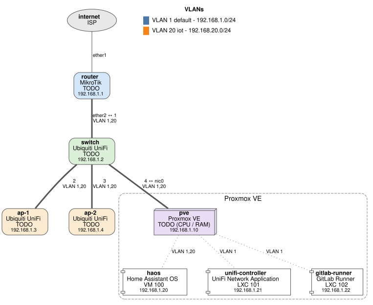
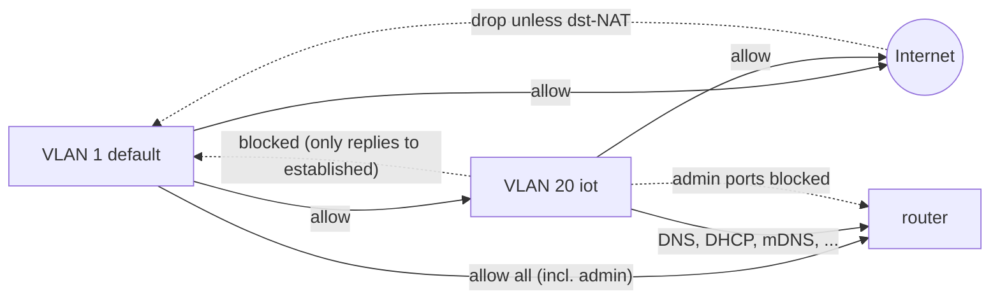

# Network overview

Generated from [`inventory.yaml`](../inventory.yaml) by `make generate`. Edit the inventory, not the SVG.

IPs, devices, switch ports and WiFi networks: [inventory.md](inventory.md) (generated from
[`inventory.yaml`](../inventory.yaml)). This page explains the design; device pages:
[MikroTik](mikrotik/README.md), [UniFi](unifi/README.md), [Proxmox](../servers/proxmox/README.md).

## Design

Vendor-neutral description, which is what you rebuild from on any hardware.

- **WAN:** ISP via DHCP client on router `ether1`. Router ignores ISP DNS (`use-peer-dns=no`). IPv6 disabled.
- **VLAN 1 `default` (192.168.88.0/24):** trusted clients and all infrastructure management.
  Untagged everywhere.
- **VLAN 20 `iot` (192.168.20.0/24):** IoT devices. Internet allowed, no access to `default`,
  no access to router admin.
- **Router:** MikroTik, one VLAN-filtering bridge. `ether2` is the trunk to the switch
  (VLAN 1 untagged + VLAN 20 tagged). Router also broadcasts the IoT WiFi itself (see below).
- **Switch:** UniFi USW-24-PoE, all ports on the default "All" profile (native VLAN 1,
  all VLANs tagged). APs carry the IoT SSID tagged on VLAN 20.
- **Proxmox:** single NIC, non-VLAN-aware bridge, so all guests sit in VLAN 1.
- **DHCP:** router serves both VLANs (lease 10 min on default, default 30 min on IoT).
  **No static leases.** Infrastructure that is not statically configured can change IP.
- **DNS:** router is resolver for both VLANs, upstream `1.1.1.1`, `8.8.8.8`. Static record `router.lan`.
- **mDNS:** router repeats mDNS between `bridge` and `vlan20_iot` so Home Assistant (VLAN 1)
  can discover IoT/ESPHome devices.
- **NTP:** router syncs from `time1.google.com`, time zone Europe/Prague.

## WiFi

SSIDs and bands: [inventory.md](inventory.md#wifi). The IoT SSID is broadcast by the UniFi APs
**and** by the router (`wlan1`) on purpose. The router's 5 GHz network is disabled.
Real SSIDs and passwords: password manager (kept out of this public repo).

## Firewall intent

Router firewall in words (source of truth for the rules: [`export.rsc`](mikrotik/export.rsc)).

**Input (traffic to the router itself):**

| # | Match | Action |
|---|-------|--------|
| 1 | established / related / untracked | accept |
| 2 | invalid | drop |
| 3 | ICMP | accept |
| 4 | dst 127.0.0.1 (CAPsMAN loopback) | accept |
| 5 | from IoT subnet to TCP 22, 80, 443, 8291 (SSH, web, Winbox) | drop |
| 6 | mDNS (224.0.0.251:5353 UDP) from LAN list | accept |
| 7 | anything not from LAN list (= WAN) | drop |
| - | everything else (VLAN 1, rest of IoT) | accept (default) |

> **Lockout warning:** no input rule explicitly accepts LAN traffic. VLAN 1 (and IoT DNS/DHCP/NTP)
> reaches the router only because RouterOS accepts anything that falls off the end of the chain.
> If you ever add a final "drop all" input rule, first add an explicit accept for `bridge`
> (and the IoT services) above it, or you will lock yourself out of the router.

**Forward (traffic through the router):**

| # | Match | Action |
|---|-------|--------|
| 1-2 | IPsec in/out policy | accept |
| 3 | established / related | fasttrack |
| 4 | established / related / untracked | accept |
| 5 | invalid | drop |
| 6 | new from WAN not dst-NATed | drop |
| 7 | from `vlan20_iot` to 192.168.88.0/24 | drop |
| 8 | from IoT subnet to WAN | accept |
| - | everything else | accept (default) |

**NAT:** masquerade on WAN. **Port forwards: none.**

**Router services:** SSH, Winbox, WWW(S) only from 192.168.88.0/24; FTP, Telnet, API disabled.
MAC-Winbox / neighbor discovery only on `bridge` (interface list `MGMT`).

## Clients on the IoT VLAN

Wireless, DHCP. Types only (hostnames contain serial numbers, so they are kept out of git):
Bosch washer, dryer, dishwasher; Electrolux appliance; TV; robot vacuum; a smart-home gateway.

## Observations / TODO

See the [Next steps checklist](../TODO.md).
