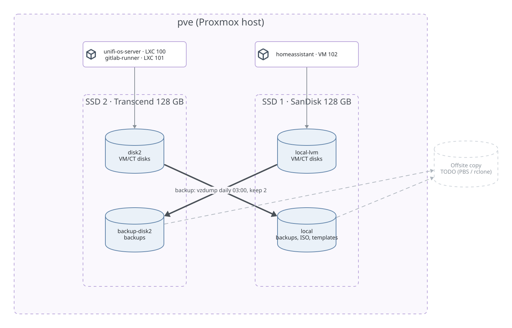

# Proxmox VE

| | |
|---|---|
| Node name | password manager (kept out of this public repo) |
| Hardware | Intel Core i5-4210U (2 cores / 4 threads), 12 GB RAM |
| PVE version | 9.2.6 (Debian trixie, kernel 7.0.2-6-pve), `pve-no-subscription` repo |
| Web UI | https://192.168.88.10:8006 |
| Read-only access | API token `claude@pve!docs`, role `PVEAuditor`, see [ACCESS.md](../../ACCESS.md#proxmox); `make pve-status` |

## Disks and storage

| Disk | Model | Size | SMART | Remaining life* | Used for |
|------|-------|------|-------|-----------------|----------|
| SSD 1 `/dev/sda` | SanDisk SD6SB1M128G | 128 GB | PASSED | 100 % | boot, VG `pve` |
| SSD 2 `/dev/sdb` | Transcend TS128GMSM360 | 128 GB | PASSED | 85 % | VG `disk2` |

\* Proxmox "wearout" value. Vendors report it differently; confirm with `smartctl -A`.



| Storage | Type | On disk | Content | Size |
|---------|------|---------|---------|------|
| `local` | dir `/var/lib/vz` | SSD 1 | ISO, templates, **backups** | 41 GB |
| `local-lvm` | LVM-thin `pve/data` | SSD 1 | VM/CT disks | 58 GB |
| `disk2` | LVM-thin `disk2/disk2` | SSD 2 | VM/CT disks | 125 GB |
| `backup-disk2` | dir `/mnt/pve/backup-disk2` | SSD 2 | **backups** | 52 GB |

## Networking

```
nic0   (onboard 1G) -> switch port 21
vmbr0  bridge on nic0, 192.168.88.10/24, gw 192.168.88.1, not VLAN-aware
nic1, wlp2s0  unused
```

All guests are on `vmbr0`, so they live in VLAN 1 only. To put a guest into the IoT VLAN, make
`vmbr0` VLAN-aware and set `tag=20` on the guest NIC.

## Guests

IPs: [inventory.md](../../network/inventory.md#proxmox-guests).

| VMID | Name | Type | vCPU | RAM | Disk | Storage | On boot |
|------|------|------|------|-----|------|---------|---------|
| 100 | unifi-os-server | LXC (Debian) | 2 | 4 GB | 20 GB | `disk2` | yes |
| 101 | gitlab-runner | LXC (Debian, privileged, Docker) | 2 | 2 GB | 40 GB | `disk2` | **no** |
| 102 | homeassistant | VM (HAOS, q35, OVMF) | 2 | 4 GB | 50 GB | `local-lvm` | yes (stopped, not deployed yet) |

All three were created with [community-scripts](https://community-scripts.org) helper scripts.

Notes:

- **unifi-os-server:** the script grants broad device access (`lxc.cgroup2.devices.allow: a`,
  no dropped capabilities, `/dev/net/tun`, serial devices). Default for this script.
- **gitlab-runner:** re-register if lost: `gitlab-runner register` with a token from GitLab.
  `config.toml` is **not** in git.
- **homeassistant:** QEMU guest agent enabled. Created but not in use yet (planned).

## Backup jobs

See [Backups](../backups.md).
